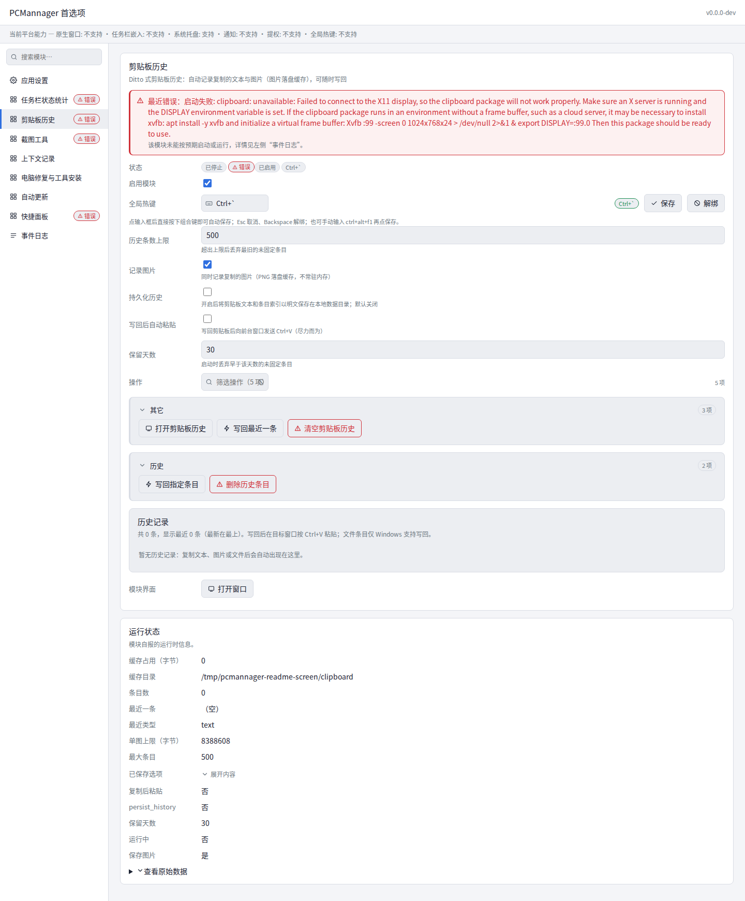
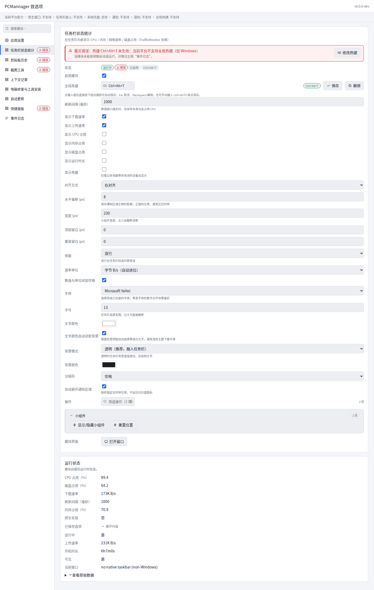
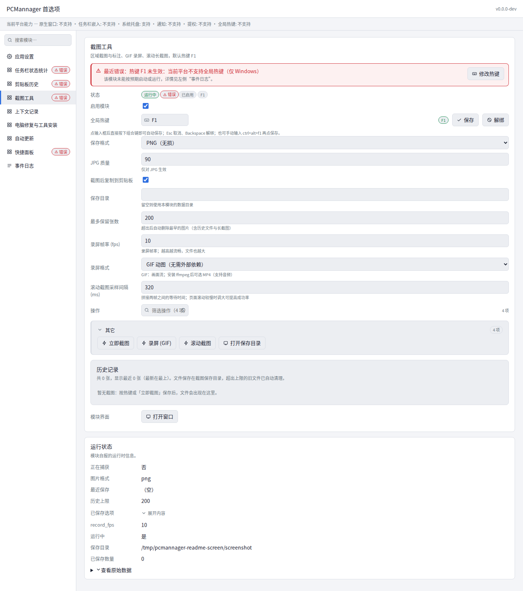
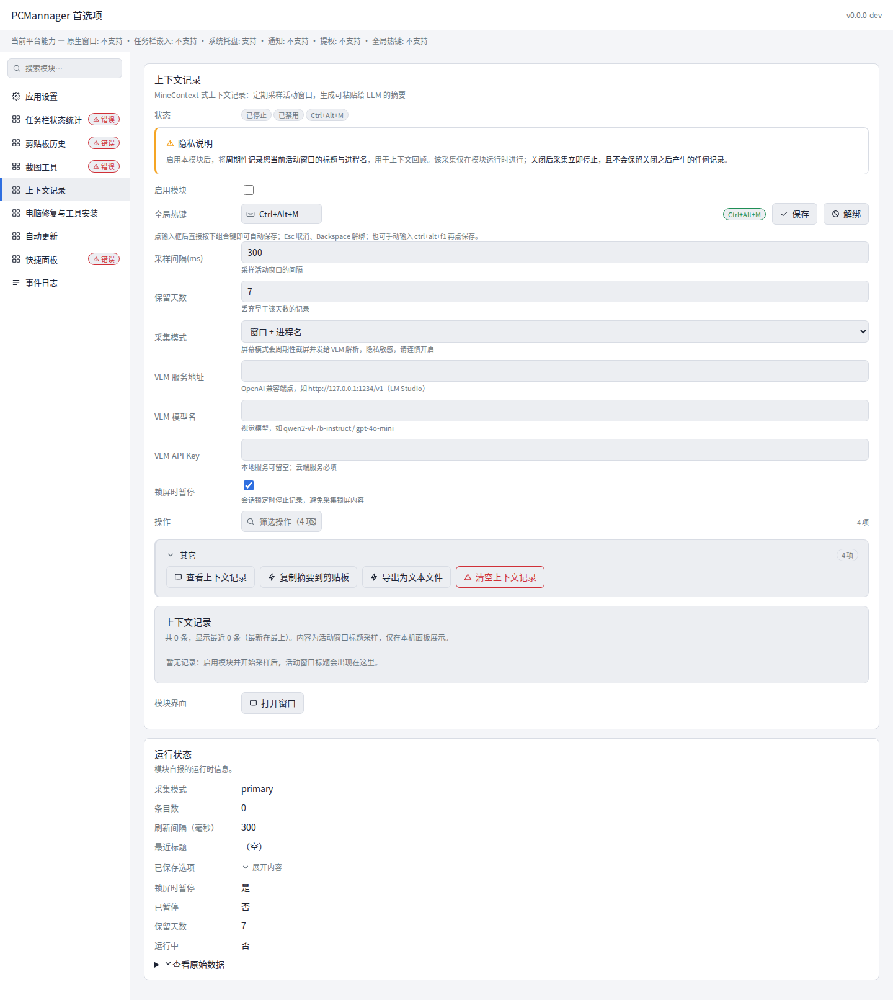
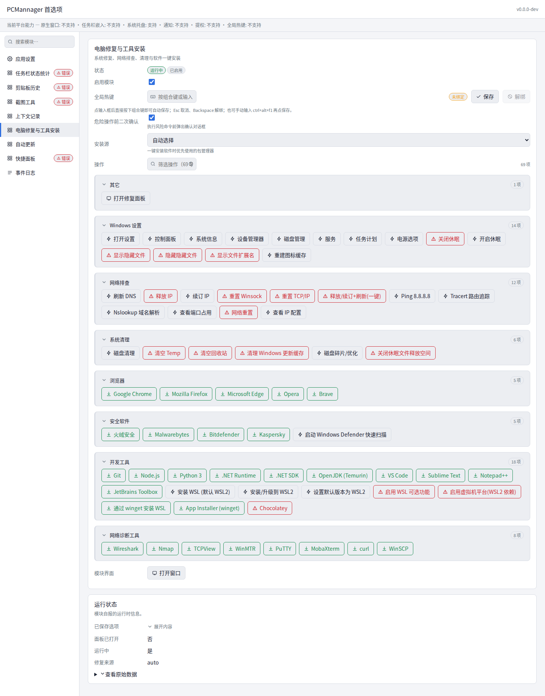
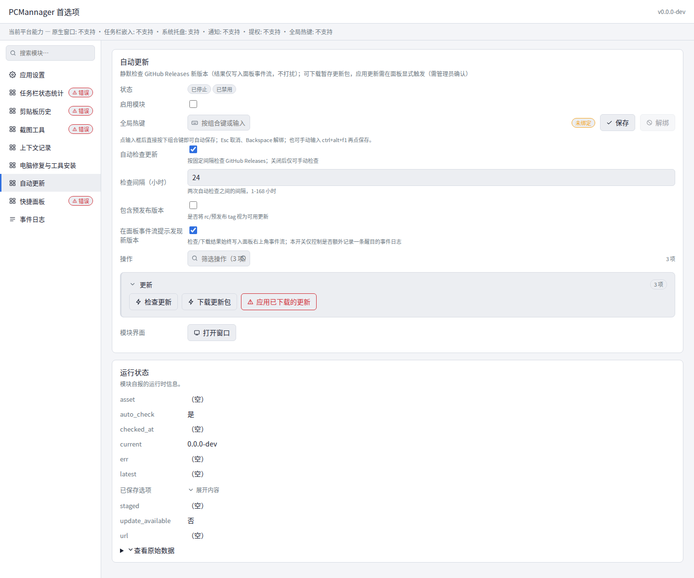
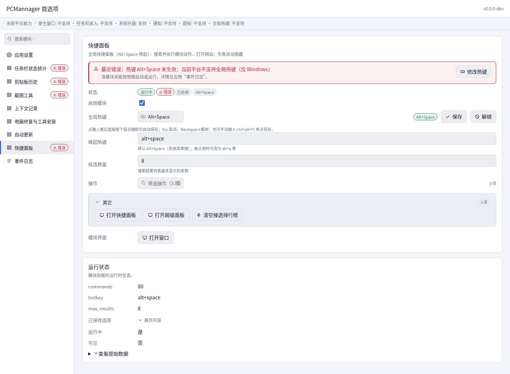
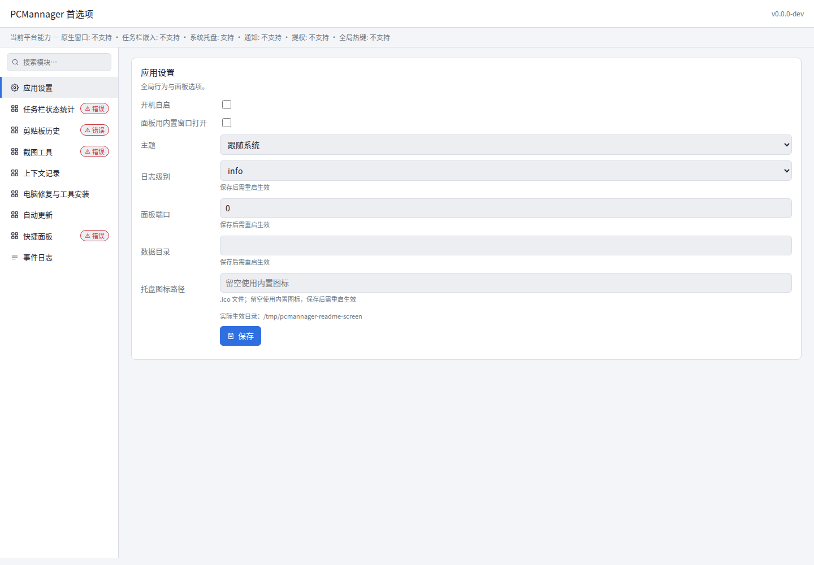

<p align="center">
  
</p>

# PCMannager

系统托盘工具（Windows 优先），用 Go 编写。集成任务栏状态、剪贴板历史、截图、工作上下文记录、电脑修复工具箱、快捷面板等模块，每个模块可独立开关并绑定全局热键。四个目标平台均可构建运行，但**构建通过不等于功能等价**：功能模块的平台成色差异显著（Windows 最完整），逐模块实测结论见下方功能表「平台可用性」列。

**设计原则**：单一二进制、`CGO_ENABLED=0` 纯 Go 构建、零 cgo 依赖（Windows GUI 走自研 `internal/winui`，基于 `syscall.LazyDLL` 直接调 Win32）。

> 规划代号（PRD 与代码内部曾用的 "GoBox"）与本仓库名 PCMannager 指代同一产品，本文档统一使用 **PCMannager**。

## 文档

| 入口 | 内容 |
| :--- | :--- |
| [项目主页](docs/site/index.html)（GitHub Pages） | 下载、功能概览、快捷键速查 |
| [Wiki](https://github.com/Snow0xcc/PCMannager/wiki) | 快速开始、模块说明、快捷键、常见问题 |
| [`docs/DEVELOPMENT.md`](docs/DEVELOPMENT.md) | 工具链与本地调试 |
| [`docs/MODULE-CONTRACT.md`](docs/MODULE-CONTRACT.md) | 模块开发契约 |
| [`AGENTS.md`](AGENTS.md) | 架构约定与硬约束 |

Wiki 内容以 `docs/wiki/*.md` 为单一数据源，由 `scripts/sync-wiki.sh` 在发版时渲染并同步（`{TAG}`/`{REPO}` 占位符在此替换）。修改文档请直接编辑仓库内文件，不要在 Wiki 网页上改——那里的内容会被下次发版覆盖。

**品牌资源**：品牌蝴蝶的**单一数据源是 `internal/logo/logo.go`**（按 0..100 归一化坐标程序化绘制；托盘图标由 `logo.Render` 直接光栅化成 HICON，不需要任何图标文件）。README / Wiki / Pages 展示用的 `docs/site/assets/logo.svg`（图标 + 字标）与 `icon.svg`（仅图标，站点 favicon）由 `bash scripts/gen-logo.sh` 从同一套几何导出（放在 `docs/site/` 是因为它是 Pages 的发布根）。改形状或配色请改 Go 几何后重新生成，**不要手改 SVG**；`bash scripts/gen-logo.sh --check` 可校验两者是否一致。

## 功能与状态

| 模块 | ID | 说明 | 默认热键 | 默认开关 | 平台可用性 |
| --- | --- | --- | --- | --- | --- |
| 任务栏状态 | `taskbar` | 任务栏 CPU/内存/网络/磁盘/运行时长/电量小组件（TrafficMonitor 式锚在通知区左侧，真透明背景），2×2 网格排版字段**随字号实测缩放**，文字颜色随背景明暗自适应 | `Ctrl+Alt+T` | 开 | Windows 完整；Linux/macOS 部分可用（指标采集与面板展示正常，无任务栏嵌入窗口、无电量） |
| 剪贴板历史 | `clipboard` | 文本 + 图片历史、置顶、容量裁剪、保留期清理；可选持久化到本地数据目录（默认关闭，文本以明文保存）。Windows 查看器可拖动，选中后恢复焦点并可选自动粘贴 | `` Ctrl+` `` | 开 | Windows 完整；Linux/macOS 部分可用（文本/图片历史与面板浏览/写回/删除正常；文件类型采集与写回、自动粘贴、原生查看器窗口不可用） |
| 截图 | `screenshot` | 全屏抓取 + 框选编辑器（选区浮动工具栏：矩形/椭圆/箭头/画笔标注、颜色与粗细、撤销、确认/复制/取消），png/jpg 可选，可自动复制到剪贴板；另含 **GIF 录屏**（框选后录制，独立置顶控制条）与**滚动长截图**（手动或自动滚动 + 像素条带拼接，自动滚动会注入滚轮） | `F1` | 开 | Windows 完整；Linux/macOS 不可用（编辑器窗口降级为空转，抓屏后无区域选择/保存/复制，截图直接丢弃；GIF/滚动/MP4 编码管线只能经编辑器进入，同样不可达） |
| 上下文记录 | `selfcontext` | 默认只记录活动窗口标题/进程名；可选屏幕采集并调用兼容 OpenAI 接口的 VLM 生成画面描述，支持查看、复制摘要、导出与清空 | `Ctrl+Alt+M` | **关**（隐私 opt-in） | Windows 完整；Linux/macOS 不可用（活动窗口探针恒为空，采样不产生记录；屏幕捕获与查看器不可用；导出/清空可用但数据恒为空） |
| 电脑修复与工具 | `repair` | 声明式工具箱目录，覆盖 Windows 设置、网络排查、系统清理、安全软件、开发环境、WSL 与软件安装 | — | 开 | 仅 Windows；Linux/macOS 不可用（所有动作返回「当前平台不支持」） |
| 自动更新 | `updater` | 定时检查 GitHub Releases 新版并提醒（SemVer/rc 排序、prerelease 开关）；下载走主机白名单 + sha256，经提权 helper 显式应用 | — | **关** | 全平台可用（检查/下载/校验一致；Linux/macOS 的应用更新需 root 或 setuid） |
| 快捷面板 | `launcher` | uTools 式全局搜索面板（Alt+Space）与超级磁贴池（Alt+P）：模块动作/界面入口、网页捷径、开始菜单应用；拼音首字母缩写、多因子加权排序与置顶、右键编辑关键字 | `Alt+Space` | 开 | 仅 Windows；Linux/macOS 不可用（面板/超级面板为原生窗口能力，空转降级，热键无可见响应；开始菜单应用索引亦仅 Windows） |
| 首选项 | `preferences` | 统一设置面板；**非功能模块**，是注册表的视图 | — | — | 全平台可用（设置走 HTTP 面板；原生窗口仅 Windows） |

模块 ID 是稳定契约，被配置、热键绑定与 REST API 按 ID 查找，新增 ID 须同步 `internal/config`。

### 运行界面截图

以下截图来自实际运行的 Linux HTTP 面板，不是静态模型图。当前采集环境没有桌面剪贴板会话，也不是 Windows，因此截图展示的是面板配置、状态与平台降级提示；它们不代表 Windows 原生窗口或系统集成功能已在本环境验收。

<details>
<summary>剪贴板历史：headless 环境空状态</summary>
<br>

<p>容器没有 X11 剪贴板会话，模块初始化失败；Windows 剪贴板查看器及有内容的历史列表需在 Windows 实机补拍。</p>
</details>

<details>
<summary>任务栏状态：字段配置与采集状态</summary>
<br>

<p>指标采集与面板状态可见；Linux 不支持全局热键和任务栏嵌入，红色提示是当前平台限制。</p>
</details>

<details>
<summary>截图工具：格式、标注、录屏和滚动截图选项</summary>
<br>

<p>这是面板配置页；截图编辑器、实际捕获、GIF/MP4 录制和滚动拼接需 Windows 实机验证。</p>
</details>

<details>
<summary>上下文记录：隐私设置与 VLM 配置</summary>
<br>

<p>模块默认关闭。屏幕采集模式会把画面发送至配置的 VLM 端点；截图仅展示配置界面，没有采集真实用户画面。</p>
</details>

<details>
<summary>电脑修复工具箱：分类目录与动作</summary>
<br>

<p>截图展示实际目录数据；在 Linux/macOS 上动作不执行，所有工具需在 Windows 实机验证。</p>
</details>

<details>
<summary>自动更新：检查、下载和显式应用</summary>
<br>

<p>模块默认关闭；本次截图未执行网络检查、下载或替换，更新全链路仍需按发版清单验收。</p>
</details>

<details>
<summary>快捷面板：搜索热键与超级面板入口</summary>
<br>

<p>Linux 不支持该模块的全局热键和原生搜索窗口；快捷面板与超级面板的实际交互需 Windows 实机截图。</p>
</details>

<details>
<summary>应用设置：全局配置与面板选项</summary>
<br>

<p>截图使用隔离的临时数据目录，路径仅用于本次采集。</p>
</details>

### 常用操作流程

| 功能 | 操作入口 | 使用说明与边界 |
| --- | --- | --- |
| 托盘与首选项 | 通知区/菜单栏图标；首选项面板 | 从托盘启停模块、打开设置或退出；面板可改模块选项、热键与开机自启。HTTP 面板监听回环地址；Windows 可选 WebView2 原生窗口。 |
| 任务栏状态 | 启动后查看 Windows 任务栏 | 在模块设置中选择 CPU、内存、磁盘、网络、电量和运行时长等字段；可调布局、字号、单位、颜色与位置。Linux/macOS 只提供采集与面板状态，不嵌入任务栏。 |
| 剪贴板历史 | 复制内容；按 `` Ctrl+` `` 打开历史 | 支持文本、图片和 Windows 文件条目；历史列表可写回或删除。`persist_history` 默认关闭；开启后文本以明文保存到本地数据目录，并按条数/保留期清理。 |
| 截图、录屏与长截图 | 按 `F1` 或在面板执行对应动作 | 框选后可标注、撤销、复制或保存；GIF 录屏使用独立控制条，安装 `ffmpeg` 后才提供 MP4；滚动长截图可手动或自动滚动，自动模式会移动光标并注入滚轮。当前编辑器只在 Windows 可用。 |
| 上下文记录 | 先在设置中启用，再按 `Ctrl+Alt+M` 查看 | 默认关闭；默认模式仅记录窗口标题/进程名。选择屏幕采集模式并配置 VLM 后，截屏会发送至所配置的本地或云端服务，请先确认数据处理范围。支持复制摘要、导出和清空。 |
| 电脑修复工具箱 | 首选项面板中的“电脑修复与工具安装” | 选择网络诊断、系统维护或软件安装等目录项；危险操作会二次确认，管理员操作可能触发系统提权。工具仅支持 Windows。 |
| 快捷面板与超级面板 | `Alt+Space` 搜索；`Alt+P` 打开超级面板 | 搜索模块动作、网页快捷项和本地应用；可编辑关键词/拼音别名、置顶排序，并将常用命令固定到磁贴池。仅 Windows 原生窗口提供完整功能。 |
| 自动更新 | 在面板启用 `updater`，然后执行检查/下载/应用 | 下载只暂存，不会自动运行；应用更新须用户明确确认并经过提权。Linux/macOS 替换程序需要相应文件权限。模块默认关闭。 |

## 快速开始

```bash
# 克隆（reference/ 是 submodule，必须一并拉取）
git clone --recurse-submodules <repo-url> pcmannager
cd pcmannager
# 已克隆则补：git submodule update --init --recursive

# 构建并运行（当前平台）
bash scripts/build.sh linux amd64 dist/pcmannager && ./dist/pcmannager

# 调试：用环境变量指向另一份配置目录
PCMANNAGER_CONFIG=/tmp/pcm-conf ./dist/pcmannager
```

启动后 Windows 通知区 / macOS 菜单栏出现托盘图标（Linux 需会话里有 StatusNotifierWatcher）；首选项面板监听 `127.0.0.1`（端口取自 `app.server_port`，`0` 表示由 OS 分配），启动日志会打印面板 URL。

## 构建、测试与检查

需要 **Go 1.27+**（`go.mod` 声明 `go 1.27.1`）。

```bash
# 构建前基线：Go 版本、构建标签契约、依赖一致性、gofmt、workflow、vet
bash scripts/preflight.sh windows amd64

# 发布构建：唯一入口，CI 与本地同源（先跑基线；对 Windows 自动追加 -H windowsgui）
bash scripts/build.sh windows amd64 dist/pcmannager-windows-amd64.exe
bash scripts/build.sh darwin  arm64  dist/pcmannager-darwin-arm64

# 日常检查
go build ./...
go vet ./...
gofmt -l .                      # 格式化：gofmt -w .
bash scripts/check-emoji.sh     # 前端禁用 emoji 检查
bash scripts/check-workflows.sh # workflow YAML 结构（GitHub 会拒绝非法 workflow）

# 测试（用例数以实测为准，文档不手写具体数字）
grep -rn "^func Test" --include=*_test.go internal/ modules/ | wc -l
go test -count=1 ./internal/... ./modules/...
# 竞争检测需要 cgo；发布构建仍保持 CGO_ENABLED=0
CGO_ENABLED=1 go test -race ./modules/clipboard
```


> `internal/server` 与 `modules/updater` 的部分用例用 `httptest.NewServer` 监听回环端口，在禁止监听套接字的环境（如受限沙箱）会失败；这是环境限制而非代码缺陷。`modules/preferences` 的用例走 `app.New()` 读配置目录，可用 `PCMANNAGER_CONFIG` 指向可写目录后运行。

> **Windows 发布必须走 `scripts/build.sh`**：Go 默认按 console 子系统构建，漏掉 `-H windowsgui` 会在启动时弹出黑色控制台窗口；漏掉 `-tags production` 则会让 Wails 退回桩实现并弹出英文错误框。脚本会先跑 `scripts/preflight.sh`，末尾再对产物做两项硬校验（内嵌标签 + PE 子系统），不满足就删除产物并失败。代价是 GUI 子系统下 stdout/stderr 不可见，排障请看数据目录下的 `logs/gobox.log`、**程序目录下的 `logs/gobox.log`** 或面板的事件日志页。


四个目标平台 `windows/amd64`、`linux/amd64`、`darwin/amd64`、`darwin/arm64` 均以 `CGO_ENABLED=0` 构建通过。更详细的工具链与本地调试见 [docs/DEVELOPMENT.md](docs/DEVELOPMENT.md)。

## 架构

```
main.go                  注册功能模块（taskbar · clipboard · screenshot · selfcontext · repair · updater · launcher） → app.New() → StartPanel/StartTray → Run() 阻塞
  │
  ├─ internal/app        装配层：config / logx / Bus / HotkeyManager / tray / panel
  │                      实现 server.Provider（依赖方向 app → server，反向会成环）
  ├─ internal/core       Module 契约 · Bus(事件广播) · HotkeyManager
  ├─ internal/config     YAML 配置，原子写入 + 缺省合并
  ├─ internal/server     HTTP REST + SSE，仅监听 127.0.0.1
  │    └─ internal/panel/index.html   面板唯一前端资源（embed 内置，两种传输共用）
  ├─ internal/wailsapp   原生窗口（Wails/WebView2，Windows only；其它平台返回 ErrUnsupported）
  └─ modules/*           taskbar · clipboard · screenshot · selfcontext · repair · updater · launcher · preferences
平台层：internal/winui（自研免 cgo Win32：窗口/任务栏嵌入/DPI/托盘/注册表）
        internal/tray · internal/sysutil（提权/自启/单实例/通知）· internal/paths · internal/logx
```

**面板数据单一来源**：HTTP 面板与 Wails 原生窗口渲染同一个 `internal/panel/index.html`（`//go:embed` 不能跨目录，故资源集中于此），且都只读 `server.Provider`，两套 UI 不会漂移。

### 平台隔离策略

Windows 专用 UI 放 `_windows.go`（`//go:build windows`），非 Windows 由 `_other.go`（`//go:build !windows`）提供同名 no-op 函数降级；非 Windows 端不得 import `walk`/`w32`。`internal/winui` 整体在非 Windows 降级为 `errUnsupported`。新增平台相关功能须成对补全两端实现。

### 开发约定（摘要，完整版见 `AGENTS.md`）

- 新增模块实现 `core.Module`（可嵌入 `core.Base`），构造函数统一 `func NewFeature() core.Module`，在 `main.go` 注册。
- 需要重启才生效的配置项用 `core.Option.Restart: true` 声明，**禁止**再用 Help 字符串前缀 `[restart]` 承载这类元数据。
- 日志统一 slog 风格（`ctx.Logger.Info("msg", "k", v)`），禁用 `Infof/Warnf/Errorf`。
- 热键语法 `mod+mod+key`（如 `ctrl+alt+f1`），由 `core.ParseHotkey` 解析；全局热键为 Windows-first，非 Windows 注册返回 `errHotkeyUnsupported`。
- 模块通过 `Bus` 发布日志/进度/通知事件供面板展示；`taskbar` 走独立配置，其余模块走各自 `FeatureConfig`。

## 首选项面板

- **跨平面板（全平台可用）**：`internal/server` 提供 JSON REST + SSE，前端为 `internal/panel/index.html`，仅监听回环地址。

- **原生窗口（Windows，已接线）**：`internal/wailsapp` 用 Wails/WebView2 把同一份前端装进原生窗口。当前依赖 `wails/v2 v2.17.0`，在 `CGO_ENABLED=0` 下保持项目免 cgo 构建约束。该包已实现 `API` 绑定层（`State`/`Modules`/`Module`/`PatchModule`…，是 `server.Provider` 的薄适配），**已在 `internal/app` 接线**（`main.go` 调 `runNativeWindow`：Windows 起独立 `LockOSThread` goroutine 跑 `wailsapp.Run`，托盘消息泵留在主线程；非 Windows 为 no-op，自动回退浏览器面板）。**必须带 `-tags production` 构建**（`scripts/build.sh` 已固定）：缺标签时 Wails 会链接到报错桩并弹出英文错误框。`scripts/preflight.sh` 在构建前断言标签生效，运行时另有 `debug.ReadBuildInfo` 自检（缺标签返回 `ErrMissingBuildTag` 并回退浏览器面板）。


REST 接口：

| 方法 | 路径 | 说明 |
| --- | --- | --- |
| GET | `/api/state` | 版本 + 应用设置 + 模块 + 平台能力 |
| GET / PATCH | `/api/app` | 应用级设置（开机自启、主题、日志级别、语言…） |
| GET | `/api/modules`、`/api/modules/{id}` | 模块快照（含当前生效的 option 值） |
| PATCH | `/api/modules/{id}` | 改开关 / 热键 / 选项 |
| POST | `/api/modules/{id}/actions/{action}` | 执行模块动作 |
| POST | `/api/modules/{id}/hotkey`、`/ui` | 触发热键、打开模块窗口 |
| POST | `/api/hotkey/validate` | 热键语法校验 |
| GET | `/api/events` | SSE 事件流（日志 / 进度 / 通知） |

### 前端显示规范：禁用 emoji

客户端界面（Web 面板、Wails 前端与任何原生 UI）**严禁 emoji 字符**作为图标或装饰，一律用 icon 资源替代——面板图标当前是 `internal/panel/index.html` 的内联 SVG（`icon(name)` 生成），原生托盘与任务栏走 `internal/winui` 的 `TrayIcon` 等句柄。此约束优先于"美观/快捷"类考量。

已落地自动化检查：`bash scripts/check-emoji.sh`（扫描 html/css/js/md/go，正则覆盖 emoji 与符号区段），并在 `.github/workflows/release.yml` 中作为独立 `lint` job，`build` 通过 `needs: lint` 串在其后——emoji 违规会直接卡住发布。

## 托盘与开机自启

**托盘**：三个平台各有实现，菜单统一由 `internal/app` 动态生成（打开面板 / 模块开关勾选 / 打开各模块窗口 / 开机自启 / 退出），关闭窗口只回托盘不退出进程。

| 平台 | 实现 | 位置 |
| :--- | :--- | :--- |
| Windows | `Shell_NotifyIconW` + 自研 `internal/winui`（彩色菜单项走 owner-draw） | `internal/tray/tray_windows.go` |
| macOS | AppKit `NSStatusBar`（菜单栏 status item + NSMenu），经 **purego** 的 Objective-C runtime 调用，**不引入 cgo** | `internal/tray/tray_darwin.go` |
| Linux | `StatusNotifierItem` + `com.canonical.dbusmenu`（纯 Go D-Bus，godbus） | `internal/tray/tray_linux.go` |
| 其它 | no-op，面板就是控制面 | `internal/tray/tray_other.go` |

两条平台约束：

- **macOS 的 AppKit 只能在主线程动**：`main_darwin.go` 用 `init()` 把主 goroutine 锁在主线程，`app_darwin.go` 的 `Run()` 在主线程泵 CFRunLoop（否则图标能显示但菜单点了没反应），所有托盘操作经 `onMain` 派发回主线程。
- **AppKit / Foundation 要显式 `dlopen`**：纯 Go 二进制不链接这两个框架，不加载时 `objc_getClass` 直接返回 0（曾一度靠某个依赖顺带载入才可用，已改为确定加载）。

**托盘角标**：托盘图标右上角可叠加红色数字气泡（`Tray.SetBadge`，空串清除），绘制统一在
`internal/tray/badge.go` 的 `BadgeOverlay`（手工 3x5 点阵数字 + 胶囊气泡，纯 Go，无字库依赖）。当前接线：
剪贴板模块每条历史变更经 Bus 状态事件实时驱动，角标 = 历史条数（模块停用或清空即清除），
见 `internal/app` 的 `badgeWatch`；`SetBadge` 三平台均实现（Windows 经 `winui.IconFromRGBA` 换 HICON）。

面板 `GET /api/state` 的 `capabilities.tray_icon` 由 `tray.Supported()` 给出（构建是否**带托盘实现**），它与「当前是否真显示得出来」是两回事：Linux 没有 D-Bus 会话或没有 watcher、macOS 没有菜单栏会话时 `Show()` 会返回错误并记日志，此时仍以面板为控制面。

**开机自启**：`sysutil.SetAutostart/IsAutostart` 已实现，并在三条路径接线——启动时 `App.SyncAutostart()` 对齐配置与系统状态、托盘菜单开关、面板 `PATCH /api/app`。Windows 写 `HKCU\Software\Microsoft\Windows\CurrentVersion\Run`，Linux 写 `~/.config/autostart/*.desktop`（XDG），macOS 写 `~/Library/LaunchAgents/cc.snow0xcc.<name>.plist`（launchd 用户代理，登录时自动加载；Label 为 `cc.snow0xcc.gobox`）。三平台共用同一条接线，语义一致：开启幂等、关闭幂等、关闭不存在的条目不算错误。

## 自动更新

由 `modules/updater` 实现（**模块默认关闭**，需在面板中开启 `updater` 后 `auto_check` 才生效）：定时检查 GitHub Releases，SemVer 比较含 rc 排序，`include_prerelease` 为 opt-in。下载走**主机白名单**（`api.github.com`/`github.com`/`objects.githubusercontent.com`，per-dial `Control` 钩子校验，重定向同样受控）+ 原子暂存 + sha256 校验，单个资产上限 128 MiB。

**应用更新必须显式确认**：`apply_update` 经 `sysutil.RunElevated` 执行 PowerShell helper（等进程退出 → 备份 → 替换 → 重启），绝不自动执行下载物。版本基准来自 `core.AppControl.Version()`，与构建注入的 `internal/app.Version` 同源。

镜像池按优先级轮询（ghfast.top → ghproxy.net → github.moeyy.xyz → 直连兜底），便于国内访问。

面板动作三步走：`check_now` 检查 → `download` 下载平台匹配资产 → `apply_update`（danger+admin）经提权 helper 显式应用；托盘菜单的"检查更新"入口尚未加（现仅面板动作），真实替换流程仍需 Windows 实机验证。

配置项：`auto_check`（默认**开**，1–168 小时间隔）、`include_prerelease`（默认关）、`notify`（面板事件流提示）。

## 配置

配置文件为数据目录下的 `config.yaml`（首次运行按 `internal/config.Default()` 生成），数据目录解析见 `internal/paths`：Windows `%APPDATA%\GoBox`、Linux `$XDG_CONFIG_HOME/GoBox`，可由 `app.data_dir` 覆盖。调试时可用 `PCMANNAGER_CONFIG` 指向其它目录（也接受配置文件路径，取其父目录）——它会同时搬走 `config.yaml` 与数据目录（日志、模块数据），不会只搬一半；优先级为 `app.data_dir` > `PCMANNAGER_CONFIG` > 系统默认。

日志同时写入**两处**：数据目录 `logs/gobox.log` 与**程序所在目录** `logs/gobox.log`（后者用 `EvalSymlinks` 解析 exe 真实路径）。无控制台的 GUI 构建可就地查看程序目录的日志。

```yaml
app:
  autostart: false
  theme: auto
  log_level: info
  data_dir: ""
  server_port: 0            # 0 = 由 OS 分配
  open_in_webview: false
  language: zh-CN
modules:
  taskbar:     { enabled: true,  hotkey: "Ctrl+Alt+T", options: { interval: 1000, layout: two-line, ... } }
  clipboard:   { enabled: true,  hotkey: "Ctrl+`",     options: { max_items: 500, store_images: true, persist_history: false, ... } }
  screenshot:  { enabled: true,  hotkey: "F1",         options: { format: png, jpg_quality: 90, ... } }
  selfcontext: { enabled: false, hotkey: "Ctrl+Alt+M", options: { interval: 300, retention_days: 7, ... } }
  repair:      { enabled: true,  hotkey: "",           options: { prefer_source: auto, confirm_danger: true } }
  updater:     { enabled: false, hotkey: "",           options: { auto_check: true, interval_hours: 24, include_prerelease: false } }
  launcher:    { enabled: true,  hotkey: "Alt+Space",  options: { hotkey: alt+space, max_results: 8 } }
```

写入是原子的（临时文件 + rename），缺省值在加载时合并，旧配置缺键会自动回填。可在面板中修改，也可手动编辑后重启。

## 发布

推送形如 `v1.2.3` 的 tag 会触发 `.github/workflows/release.yml`：先跑 `lint`（emoji 检查），再矩阵构建 `windows/amd64`、`linux/amd64`、`darwin/amd64`、`darwin/arm64`，产物命名 `pcmannager-<os>-<arch>[.exe]`，上传并发布到 GitHub Release。

```bash
git tag v1.0.0
git push origin v1.0.0
```

> 发布端到端验收以 `TODO.md` #1 和 [发版清单](docs/RELEASE-CHECKLIST.md) 的当次记录为准；两份文档的记录状态尚未完全对齐，发版前请核对 Actions 运行、四平台附件与 Wiki 同步结果。

## 已知限制

- **跨平台成色差异大（D1 如实标注）**：四平台构建均通过，但功能不等价——全局热键在非 Windows 不可用（托盘三平台均已实现，macOS/Linux 未经真机验证）；`screenshot`/`selfcontext`/`repair`/`launcher` 核心能力不可用，`taskbar`/`clipboard` 部分可用，`updater`/`preferences` 全平台可用。逐模块实测结论见上方功能表「平台可用性」列。
- **真实 Windows 验收部分完成**：托盘启退循环、热键触发、任务栏小组件嵌入、Wails 原生窗口、截图编辑器、剪贴板历史窗口已在本机 Windows 实跑验证；Explorer 重启恢复等边界场景仍未覆盖。
- **热键可能被占用**：`F1`、`` Ctrl+` ``、`Alt+Space` 在部分机器已被其它程序占用（如 PowerToys Run 抢占 Alt+Space）。Windows 面板会在保存前尝试检测占用，并支持按键录制与改绑；Linux/macOS 可保存配置，但不支持本机可用性探测或全局热键触发。
- **录屏默认 GIF，装了 ffmpeg 才有 MP4**：纯 Go 无成熟 H.264 编码器，故 GIF 是默认且无外部依赖（帧缓冲上限 1200 帧，约 2 分钟 @10fps）；MP4 为 opt-in，仅在检测到外部 `ffmpeg` 时出现在选项里（可带扬声器/麦克风音频）。摄像头与麦克风**画面采集**未实现。
- **滚动截图自动滚动会注入真实滚轮事件**并把光标移到选区中心，属“控制用户电脑”的行为；纯色背景/重复内容可能因条带多处匹配而拼接失败（会平滑停止并保留已拼部分）。
- **命名残留**：`paths.AppName = "GoBox"`、窗口类名 `GoBoxTray`、日志 `gobox.log`、数据目录 `%APPDATA%\GoBox` 与产品名 PCMannager 并存（迁移设计见 [`docs/NAMING-MIGRATION.md`](docs/NAMING-MIGRATION.md)）；各 `modules/*` 包名已与目录名一致（早年 `statusbar`/`pcrepair` 旧名已改齐）。
- **托盘图标**：四级回退链（`app.tray_icon_path` → 内嵌 `assets/icon.ico` → 程序化蝴蝶标 → shell 通用图标，见 TODO #9 与 `AGENTS.md`）；三平台托盘均实现（Windows `Shell_NotifyIconW`、macOS `NSStatusBar`、Linux `StatusNotifierItem`，Windows 经 `winui.IconFromRGBA`）。
- **Linux 托盘未做真机验证**：StatusNotifierItem + dbusmenu 仅通过交叉编译与单测（菜单树、点击事件映射、图标字节序），未在真实桌面环境（GNOME/KDE）上验证显示与交互。
- **测试覆盖缺口**：`internal/winui`、`modules/launcher`、`modules/taskbar` 以及 `modules/screenshot` 的部分用例只有 Windows build tag 的测试文件，在 Linux/macOS runner 上不参与执行（仅由 `GOOS=windows` 编译闸门保证不腐烂）；`internal/tray` 亦有 `*_windows_test.go` 不参与执行，但其图标资产解析与回退链用例（`icon_test.go`）无 tag、Linux 实跑。`internal/wailsapp` 目前没有测试文件。用例总数以实测为准（见上）。

完整待办与优先级见 [`TODO.md`](TODO.md)，变更历史见 [`CHANGELOG.md`](CHANGELOG.md)，模块开发前请读 [`docs/MODULE-CONTRACT.md`](docs/MODULE-CONTRACT.md)。

## 仓库结构

```
main.go / main_{windows,other}.go   程序入口
internal/{app,core,config,server,panel,wailsapp,winui,tray,sysutil,paths,logx}/
modules/{launcher,taskbar,clipboard,screenshot,selfcontext,repair,preferences,updater}/
scripts/{build.sh,check-emoji.sh,gen-logo.sh,sync-wiki.sh,test-linux-tray-dbus.sh}   构建、emoji 检查、品牌校验、Wiki 同步、Linux 托盘 D-Bus 测试
docs/                               DEVELOPMENT（开发指南）· MODULE-CONTRACT（模块契约）
                                    · AI-PHASE-A-PROMPT · HANDOVER · PROJECT-AUDIT · competitors
reference/                          5 个第三方参考仓库（git submodule，不参与主构建，勿从中 import）
AGENTS.md / TODO.md / CHANGELOG.md  开发约定 · 待办清单 · 变更历史
```

## 许可证

仓库暂未包含 LICENSE 文件；如需开源分发请先补充。
